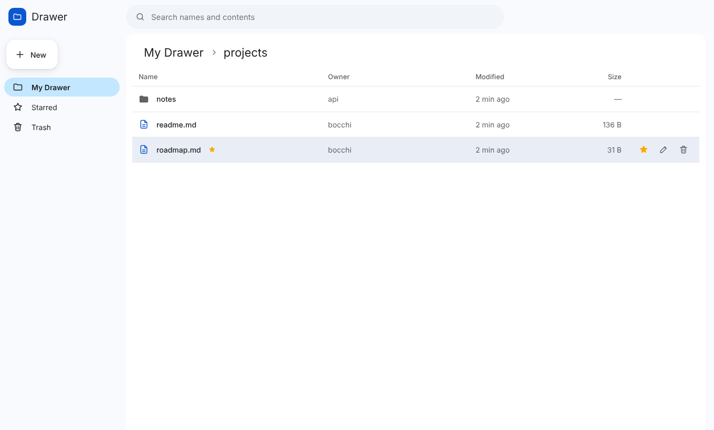
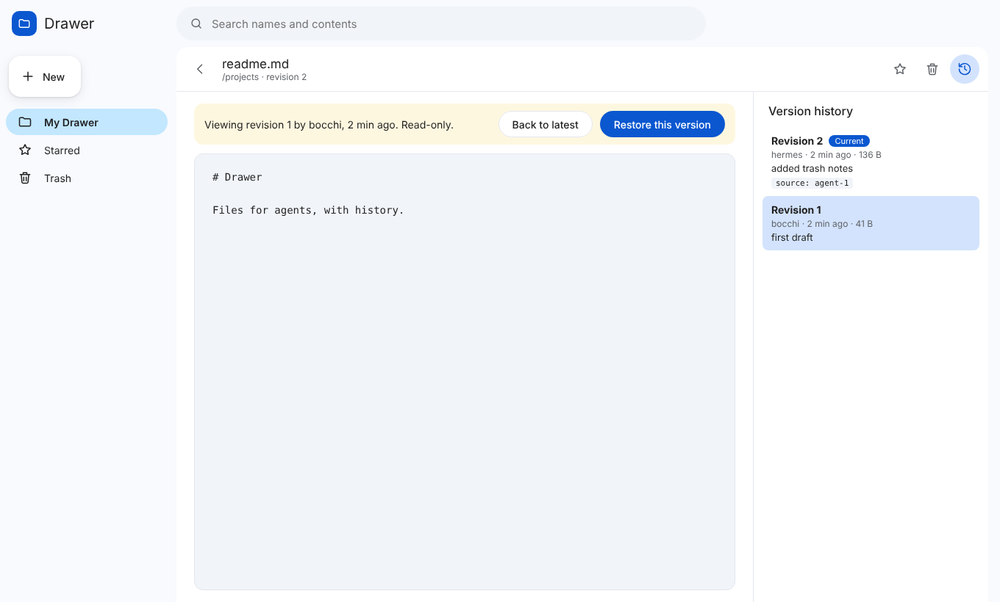
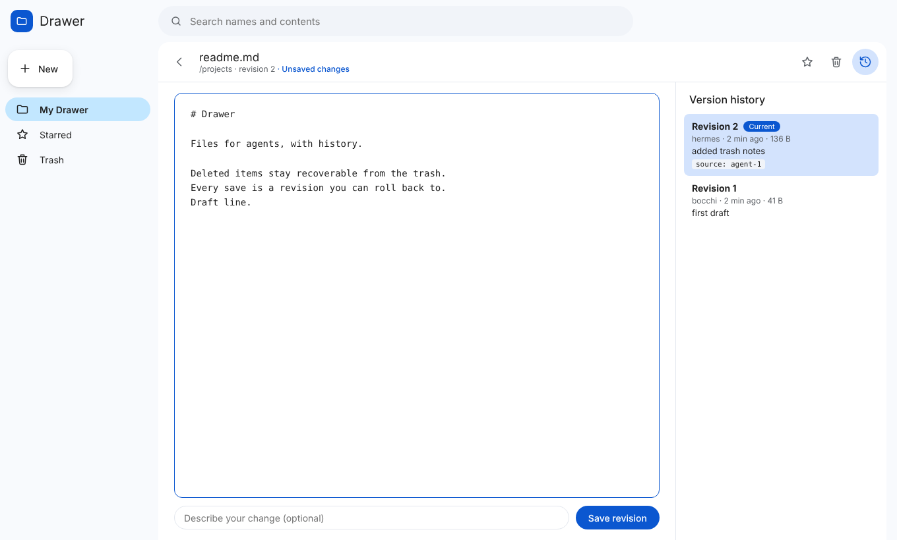
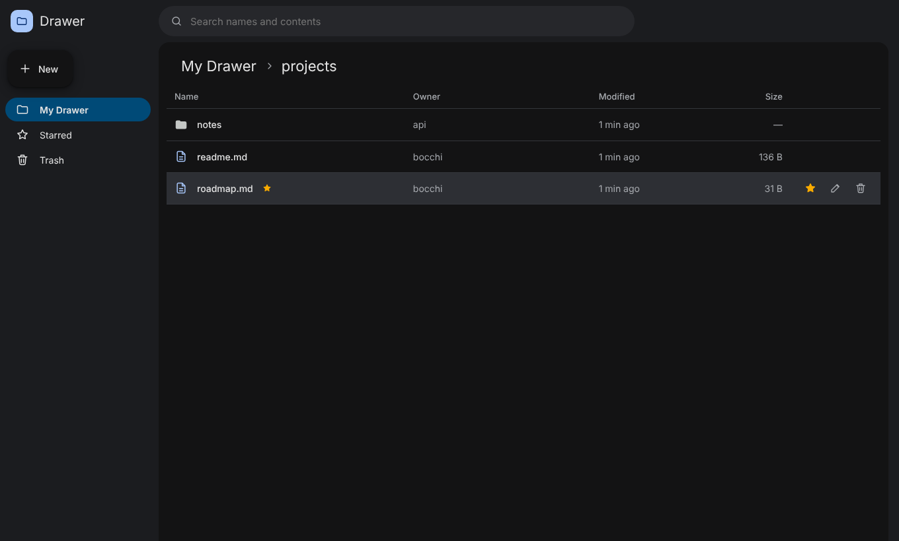

<div align="center">

# Drawer

**Versioned file storage for agents, modelled on Google Drive.**

One Rust binary serves a REST API, an MCP server and a web UI over the same store.

[](https://github.com/Anxiety471/drawer/actions/workflows/ci.yml)



</div>

Agents write files all day and sooner or later one of them overwrites something it shouldn't. Drawer keeps every version, puts deleted things in a trash, and lets two agents share a folder without silently clobbering each other's writes.

For a private Ubuntu file-transfer server, see [deploying Drawer with Docker Compose](docs/deploy.md).
The personal-server build supports an administrator password, resumable browser uploads, upload folders, and bulk file actions (see the stacked MVP PR).

## Quickstart

Linux and macOS, one command:

```sh
curl -fsSL https://raw.githubusercontent.com/Anxiety471/drawer/main/install.sh | sh
drawer serve                                # http://127.0.0.1:8787
```

The installer downloads the release for your machine, checks its SHA-256, and puts `drawer` in `~/.local/bin` with the UI in `~/.local/share/drawer/ui`. If no release exists for your platform it builds from source with cargo (installing Rust via rustup if needed).

To update an install, run `drawer update`. It fetches the latest release for your machine, checks its SHA-256 against `SHA256SUMS`, and replaces the binary and the UI in place. `drawer update --check` only reports whether a newer release exists. Restart `drawer serve` afterwards to run the new version. The store is never touched. The web UI shows an **Update to vX** button in the top bar when a newer release exists; it asks first, then runs the same update.

Drawer runs on its own; Hermes or another agent harness is optional. By default,
all store commands use `~/.drawer`, regardless of your current working directory:

| Path | Contents |
| --- | --- |
| `~/.drawer/drawer.db` | File metadata, revisions and download links |
| `~/.drawer/blobs/` | Content-addressed file contents |
| `~/.drawer/transfers/` | Temporary resumable uploads |

Override the location with `drawer --data-dir /path/to/store serve` or
`DRAWER_DATA_DIR=/path/to/store drawer serve`. The flag takes precedence over the
variable. If no absolute home directory is available through `HOME` or
`USERPROFILE`, set one of these explicit overrides. Docker Compose already sets
`DRAWER_DATA_DIR=/data` and continues using its named volume.

**Existing stores:** older versions defaulted to `./data`. This change does not
move or delete that directory. Keep using it with an absolute path, for example
`drawer --data-dir /home/you/old-project/data serve`. Back up the complete store
(database, WAL files if present, blobs and transfers) before relocating it while
all Drawer writers are stopped. Never copy just the uploaded files or database.

Optionally, point an agent at it. `drawer mcp-config --format <harness>` prints the exact config for Hermes, Claude Code, Codex, Gemini CLI, VS Code, opencode, or any client that takes an `mcpServers` JSON block. See [MCP and agent harnesses](#mcp-and-agent-harnesses).

## Features

- **Stable ids.** Every file and folder has an id that survives rename, move and trash. Moving a folder moves everything under it.
- **Revisions.** Every save is a new immutable revision, with its author. Diff any two revisions; rolling back adds the old content as the new head, so nothing is lost.
- **Targeted edits.** Replace an exact piece of text instead of rewriting the whole file, saved as one guarded revision. Cheaper for agents and safe alongside other writers.
- **Safe concurrent writes.** Writes accept `if_head_revision`. A stale writer gets `412 Precondition Failed` and nothing changes.
- **Trash.** Deleting moves things to the trash, with their history. Restore by id, or purge for good.
- **Star, search, copy, move.** Star files and folders, search names and contents (name matches first, content matches with line numbers), and copy without re-uploading: copies share content by hash.
- **Recent activity.** See which files changed last and which agent or person changed them.
- **Download links.** Create a 7-day link from a file's menu and copy it to anyone who can reach your server. Links download only the latest file revision, expire automatically, and can be revoked in the UI. The database stores only hashes of the link secrets.
- **Cooperative agent sharing.** Grant `reader`, `writer` or `owner` to an agent principal on a folder and it covers everything below. These grants are not user authentication; callers can self-declare their principal.
- **Custom properties.** Key/value pairs stored with each revision.
- **Any file type.** Stored byte-for-byte, up to 512 MB per upload.
- **Previews in the UI.** PDF, Word (`.docx`), Excel (`.xlsx`, `.xls`, `.ods`), CSV/TSV, Markdown, HTML, images, audio and video. Text and source code are editable with syntax highlighting. Other types (`.doc`, `.pptx`, archives) download.
- **Optional bearer token** for the HTTP API, MCP endpoint and UI.

Content is stored as sha256-addressed blobs on disk, and metadata lives in SQLite.

## Web UI

A Drive-style browser with My Drawer, Recent, Starred and Trash, a search box over names and contents (press `/`), and a version history panel on every file.

- **Live.** Open folders and files pick up what agents save within a few seconds. An unchanged file reloads itself; one with unsaved edits shows who saved what instead of losing your work.
- **See what changed.** Each revision in the history has a diff against the one before it.
- **Organise.** Sort by name, modified or size; rename, move, copy and download from a row's menu (or right-click); trashing offers Undo.
- **Links work.** The folder and open file are in the URL, so reload, back/forward and bookmarks do what you expect.
- **Token prompt.** When the server runs with a token, the UI asks for it once and remembers it in the browser.
- **Share a download.** Open a file's More actions menu, choose **Share download link**, then **Create 7-day link** and **Copy**. Reopen the menu to view expiry times or revoke an existing link. A secret is visible only when newly created, not later.

<p align="center">
  <br>
  
</p>

There is a dark theme too: 

## Command line

`drawer` with no subcommand runs `serve`. The file commands work on the store directly, so no server has to be running. Paths look like `/notes/todo.md`. Run `drawer --help` or `drawer <command> --help` for every flag.

```sh
drawer put ./report.pdf /work/            # upload into a folder (trailing / or existing folder)
drawer put - /notes/todo.md < todo.md     # from stdin; needs an explicit file path
drawer ls -l /work                        # kind, revision, size, modified, name
drawer cat /notes/todo.md > copy.md       # stdout; --revision N for an old one
drawer get /work/report.pdf               # save to ./report.pdf; --force to overwrite
drawer tree /work -L 2                    # folders and files as a tree
drawer edit /notes/todo.md --old "- [ ] ship" --new "- [x] ship"   # exact-text replace, one revision
drawer history /notes/todo.md             # revisions, newest first
drawer diff /notes/todo.md                # what the latest revision changed; or: diff PATH FROM TO
drawer rollback /notes/todo.md 2          # adds revision 2's bytes as the new head
drawer recent                             # most recently changed files, and by whom
drawer search "quarterly roadmap"         # names and contents
drawer rm /notes/old.md                   # to the trash; the id is kept
drawer trash                              # list it, with ids
drawer restore <id>                       # bring it back
drawer purge <id> --yes                   # gone for good
```

| Group | Commands |
| --- | --- |
| Run | `serve` (default), `stdio`, `update [--check]`, `doctor`, `mcp-config`, `completions <shell>` |
| Files | `ls`, `tree`, `mkdir`, `put`, `edit`, `cat`, `get`, `stat`, `mv`, `cp` |
| Versions | `history`, `diff`, `rollback`, `recent` (`cp` takes `--revision`, `cat` and `get` too) |
| Trash | `rm`, `trash`, `restore <id>`, `purge <id> --yes` |
| Search and stars | `search`, `star`, `unstar`, `starred` |
| Sharing | `perms`, `share <path> <principal> <role>`, `unshare <path> <principal>` |

Global flags: `--data-dir` (`DRAWER_DATA_DIR`, default `~/.drawer`), `--author` (`DRAWER_AUTHOR`, default `$USER`) which is recorded on every change, and `--json` for machine-readable output from commands that return data.

`drawer doctor` checks database integrity, counts, missing blob files and whether the UI is built. `drawer completions bash|zsh|fish|powershell|elvish` prints a shell completion script.

Writes are serialized inside one process. A CLI write while a server is writing to the same store can race it, so route concurrent writes through one or the other.

## MCP and agent harnesses

Drawer speaks MCP two ways:

- **Streamable HTTP** at `http://127.0.0.1:8787/mcp`, served by `drawer serve`. Best when several agents, or agents and people, share files.
- **Stdio** with `drawer --data-dir ./data stdio`. The harness starts Drawer itself.

For Hermes Agent (`~/.hermes/config.yaml`):

```yaml
mcp_servers:
  drawer:
    command: "/usr/local/bin/drawer"
    args: ["--data-dir", "/srv/drawer-data", "stdio"]
```

`drawer mcp-config` prints this for your paths. Pick the harness with `--format`, and add `--url http://127.0.0.1:8787/mcp` to connect to a running server instead of starting one:

| `--format` | Prints |
| --- | --- |
| `hermes` (default) | YAML for `~/.hermes/config.yaml` |
| `claude-code` | a `claude mcp add` command |
| `codex` | TOML for `~/.codex/config.toml` |
| `gemini` | JSON for `~/.gemini/settings.json` (`httpUrl` for HTTP) |
| `vscode` | JSON for `.vscode/mcp.json`, with a password prompt for the token |
| `opencode` | JSON for `opencode.json` |
| `json` | an `mcpServers` block for Claude Desktop, Cursor, Windsurf and most others |

The server exposes 21 tools:

| Tools | |
| --- | --- |
| `drawer_list`, `drawer_stat`, `drawer_search`, `drawer_starred`, `drawer_recent` | browse and find |
| `drawer_mkdir`, `drawer_read`, `drawer_write`, `drawer_edit` | create and change content |
| `drawer_revisions`, `drawer_diff`, `drawer_rollback`, `drawer_copy`, `drawer_move` | history and layout |
| `drawer_delete`, `drawer_trash`, `drawer_restore`, `drawer_purge` | trash lifecycle |
| `drawer_star`, `drawer_share`, `drawer_unshare` | stars and grants |

Built for how agents work:

- **Small edits stay small.** `drawer_edit` replaces an exact `old_string` with `new_string`, like the edit tools in Claude Code and Codex, so an agent doesn't resend a whole file to change a line.
- **Whole trees in one call.** `drawer_list` with `depth` up to 10 lists everything below a folder with full paths.
- **Reads say what to guard on.** `drawer_read` follows text with a `[drawer]` line giving the revision to pass as `if_head_revision`. Long files are cut at 2000 lines (or 256 KB) with a note saying how to page with `offset` and `limit`, so one read can't flood the context.
- **Lean results.** Tool results are compact JSON, and listings carry only what an agent acts on: path, kind, id, revision, size, type, when and by whom.
- **History knows who.** Calls that don't pass `author` are recorded under the client's own MCP name (`claude-code`, `codex-mcp-client`, `gemini-cli-mcp-client`, ...), or under `--author` / `DRAWER_AUTHOR` for `drawer stdio`. `drawer_recent` and `drawer_diff` then show what each agent did.
- **Portable schemas and hints.** Input schemas avoid the JSON Schema features Gemini and other strict APIs reject. Every tool has a display title and read-only/destructive hints, so harnesses can auto-approve reads and confirm `drawer_purge`, the only destructive tool.

`drawer_read` and `drawer_write` take `encoding: "base64"` for binary files such as PDF, docx, xlsx or images. `drawer_read` returns PNG, JPEG, GIF and WebP images as image content so vision models can look at them.

For concurrent agents, read the file, then write with `if_head_revision` set to the revision you read (or use `drawer_edit`, which guards itself). On a conflict, re-read and merge.

Setup for Hermes, Claude Code, Claude Desktop, Codex, Gemini CLI, Cursor, VS Code, the OpenAI Agents SDK and LangChain is in [docs/harnesses.md](docs/harnesses.md).

**Mirroring Hermes output.** MCP only saves what the agent chooses to save. [`integrations/hermes/drawer-mirror`](integrations/hermes/drawer-mirror/README.md) is a Hermes plugin that copies every successful `write_file` and `patch` into Drawer after the fact, and records the links Hermes shares. Hermes keeps its own artifacts, and both can run side by side.

## REST API

Base path `/drawer/v1`. Nodes are named by `path=` or `id=`. Mutations name their actor with the `x-drawer-author` header (default `api`). `GET /health` and `GET /drawer/v1/health` both return `{"ok": true}`. With `--token` set, both need the bearer token like everything else.

| Method | Path | Notes |
| --- | --- | --- |
| GET | `/tree?path=/` | live children of a folder; `&depth=N` for everything N levels down |
| POST | `/folders` | `{"path"}`, creates parents too |
| DELETE | `/folders?path=` or `?id=` | trash a folder (`&if_head_revision=N` optional) |
| GET | `/files?path=` or `?id=` | raw bytes; `&revision=N`; `&download=true` for an attachment. Response carries `x-drawer-revision`, `x-drawer-prop-*` and an `ETag`; `If-None-Match` gets a 304 |
| PUT | `/files?path=` | raw body; `x-drawer-comment`, `x-drawer-prop-<key>`, `&if_head_revision=N` |
| DELETE | `/files?path=` or `?id=` | trash a file (`&if_head_revision=N` optional) |
| GET | `/files/meta?path=` or `?id=` | id, head revision, size, mime, starred, trashed, properties |
| POST | `/edit` | `{"path","old_string","new_string","replace_all","author","comment","if_head_revision"}`: exact-text replace as one revision |
| GET | `/revisions?path=` or `?id=` | revision history, newest first |
| GET | `/diff?path=` or `?id=` | unified diff; `&from=N&to=M` (default: head vs the one before), `&context=N` |
| POST | `/rollback` | `{"path"\|"id","revision","author","comment","if_head_revision"}` |
| POST | `/copy` | `{"from"\|"from_id","to","source_revision","author","comment","if_head_revision"}` |
| POST | `/move` | `{"from"\|"from_id","to"}`: rename or move, keeps the id |
| PATCH | `/nodes/{id}` | `{"name","parent_id","starred","trashed"}`: rename, move, star, trash, restore |
| DELETE | `/nodes/{id}` | purge; the node must already be in the trash |
| GET | `/trash` | top-most trashed nodes |
| GET | `/starred` | starred live nodes |
| GET / PUT | `/nodes/{id}/permissions` | list grants; `PUT {"principal","role"}` (owner only) |
| DELETE | `/nodes/{id}/permissions/{principal}` | remove a grant (owner only) |
| POST | `/nodes/{id}/links` | `{"expires_in_days":7}` (1–30). Returns a one-time `token` for a read-only download link |
| GET | `/nodes/{id}/links` | list link ids, creation/expiry times, but never the secret token |
| DELETE | `/nodes/{id}/links/{link_id}` | revoke a download link |
| GET | `/s/{token}` (outside `/drawer/v1`) | public attachment download, no instance bearer token needed; 404 when invalid, expired, revoked or trashed |
| GET | `/search?q=` | names first, then contents with `line` and `snippet` |
| GET | `/recent?limit=` | live files, most recently changed first, with `modified_by` |
| GET | `/update` | is a newer release published? `{current, latest, update_available}` |
| POST | `/update` | install the latest release if newer; the server runs the new version after a restart |

Files are served with `nosniff`, and everything except PDFs gets a `sandbox` CSP, so stored HTML or SVG never runs scripts. Write responses include `new_revision`: `false` means content and properties matched the head, so nothing was added.

## Architecture

```
src/service.rs   nodes, revisions, grants, trash, search: the one service layer
src/api.rs       REST API at /drawer/v1
src/mcp.rs       MCP tools (rmcp), stdio and streamable HTTP
src/cli.rs       the drawer command
src/blob.rs      sha256 content-addressed blobs on disk
src/schema.sql   SQLite metadata (sqlx)
ui/              React, TypeScript, Vite: the web UI
integrations/    harness plugins, e.g. the Hermes drawer-mirror
```

The REST API, MCP server, CLI and UI all call the same service layer, so they agree on permissions, revisions and the trash.

**Security for download links.** Configure a strong `DRAWER_TOKEN` before using Drawer beyond a trusted local machine. The authenticated owner can create a public, read-only capability link which anyone possessing it can download until it expires or is revoked. A valid link does **not** give access to any REST API or MCP operation. Put Drawer behind HTTPS for sharing outside your private Tailscale network, and treat the URL as a password: avoid posting it in public logs or forwarding it accidentally. A link points at the latest revision and becomes unavailable while the file or any containing folder is trashed. If the server is reachable only over Tailscale, the recipient also needs access to that tailnet or a controlled public HTTPS endpoint.

**Limits.** Real user accounts don't exist yet. Actors are self-declared, so grants are cooperative, not a security boundary. Read grants aren't enforced yet. Copying folders isn't supported yet. There are no signed URLs, no blob garbage collection and no Postgres backend. Treat the optional bearer token as the access control.

**Upgrading.** Stores created on the earlier path-keyed schema are migrated in place on open. Their trashed files land in the trash. Write responses changed: `created` is now `new_revision`, and `version` is now `revision`. MCP calls without an `author` used to be recorded as `agent`; they now carry the client's name, so a sharing grant written for `agent` needs the client's name instead (or start `drawer stdio` with `--author agent`). MCP tool results are compact JSON, and the listing tools return lean entries; `drawer_stat` still returns the full node.

**Performance.** Listings, search, starred and trash resolve every path in one recursive query rather than one query per ancestor. SQLite runs in WAL mode with `synchronous=NORMAL` and a busy timeout, so a CLI command and a server can share a store without `database is locked` errors.

## Configuration

| Variable | Used by | Default |
| --- | --- | --- |
| `DRAWER_DATA_DIR` | all store commands | `~/.drawer` |
| `DRAWER_ADDR` | `serve` | `127.0.0.1:8787` |
| `DRAWER_TOKEN` | `serve` | unset (an empty value counts as unset) |
| `DRAWER_UI_DIR` | `serve` | `./ui/dist`, then `../share/drawer/ui` beside the binary |
| `DRAWER_AUTHOR` | CLI writes | `$USER` |
| `DRAWER_PREFIX` | installer | `~/.local` |
| `DRAWER_VERSION` | installer | `latest` |
| `DRAWER_SOURCE=1` | installer | build from source instead of downloading a release |

`serve` warns when it listens beyond loopback without a token.

## Development

```sh
cargo test && cargo clippy --all-targets -- -D warnings
cd ui && npm ci && npm run dev     # UI dev server, proxies /drawer to 127.0.0.1:8787
cd ui && npm run build             # type-check and build ui/dist
cargo run --release -- serve       # API, MCP and UI on http://127.0.0.1:8787
```

CI runs clippy, the Rust tests and the UI build on every push to `main` and every pull request.

Releases: pushing a `v*` tag builds Linux (x86_64, aarch64) and macOS (x86_64, aarch64) binaries and attaches them with `SHA256SUMS` (`.github/workflows/release.yml`).

## Linux background service

`drawer service install` installs and starts a per-user systemd service using your current binary and configured store. Use `--no-start` to write the unit for review, then `systemctl --user daemon-reload && systemctl --user enable --now drawer`. Existing units are never overwritten. `drawer service start|stop|status|uninstall` manages it; uninstall leaves your data in place.

Put `DRAWER_ADMIN_PASSWORD` and `DRAWER_TOKEN` in `~/.config/drawer/env` (create the parent directory and use `chmod 600` on the file) before starting. Do not put secrets in the service unit. Logs: `journalctl --user -u drawer`. To run after logout and at boot, enable user lingering with `loginctl enable-linger "$USER"` if your administrator permits it. Docker deployments should continue using Compose restart policies.

Browser uploads compute SHA-256 incrementally in a worker before sending chunks, pass the expected hash to the server and compare it with the committed revision. Resume IDs include the content hash, so selecting a different same-sized file cannot splice two files together. Hashing is bounded to 4 MiB chunks and works on private HTTP as well as HTTPS.

Public links can be fixed to a specific revision: select **Keep this link on revision N** in the share dialog, or provide `revision` when creating a link over REST. Later edits do not change that link's contents. Default links continue following the latest head. Trash, expiry and revocation apply to both modes.

Share links optionally accept a download limit (1–1,000,000) from the dialog or `max_downloads` in REST. A request consumes a use when an authorized download is issued, even if the recipient cancels the stream. Exhausted links return 404. Concurrent requests reserve uses atomically; blank means unlimited.

## Transfer manager

Open **Transfers** in the sidebar to see active, paused, failed, expired, cancelled and completed uploads. Pause, select the same file to resume/retry, or cancel its staging data. Metadata and progress survive restarts; an expired lease cannot be resumed. The last 200 entries for your actor are shown. Authenticated download requests appear as **issued**; your browser's native download manager owns their completion and retry state.
